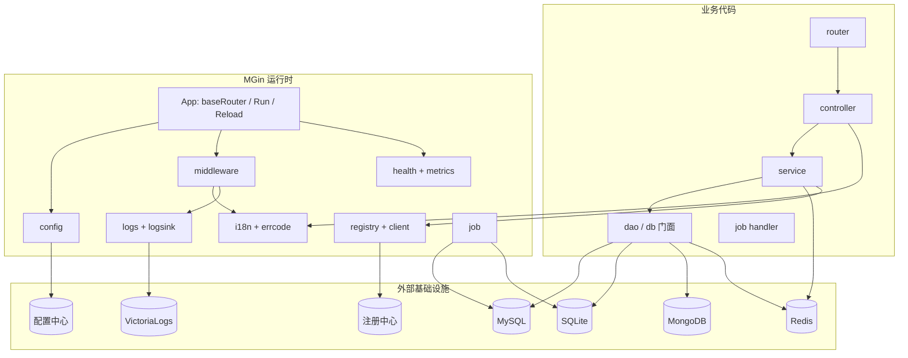
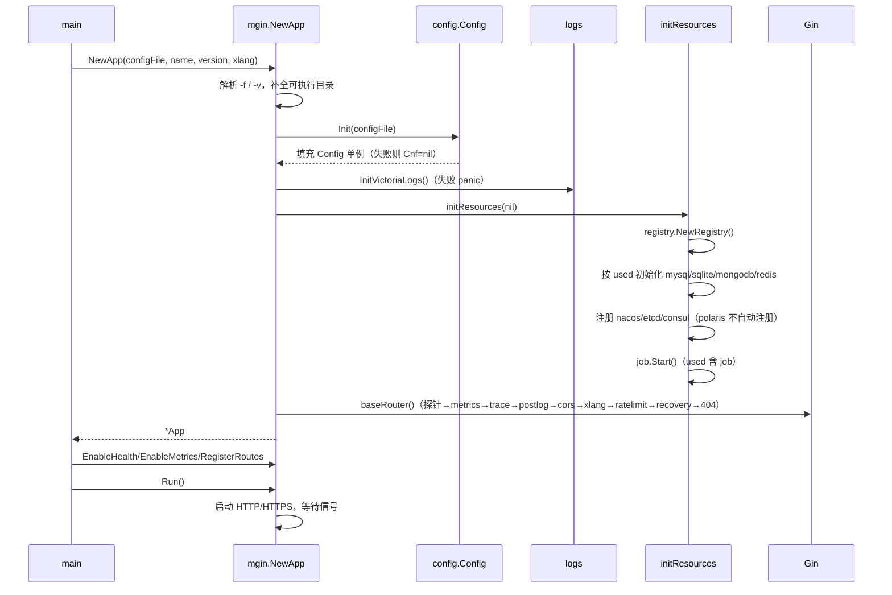
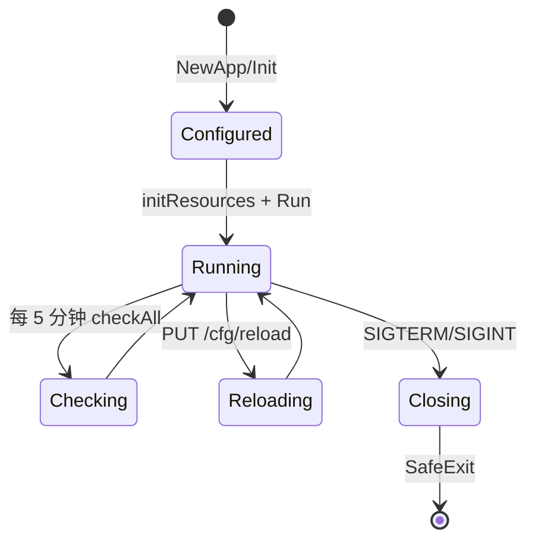

# 系统架构说明（jh 分支）

| 项 | 内容 |
|----|------|
| 代码基线 | `jh` 分支，`go.mod` 模块 `github.com/maczh/mgin`，Go 1.25.7 |
| 读者 | 需要改动框架、排查线上问题或评审设计的人 |
| 关联 | [需求文档](04-requirements.md) · [模块与接口](../08-reference/api/README.md) · [数据结构](../03-development/04-data-access.md) |

---

## 1. 架构总览

MGin 是**进程内库**（library），不是独立网关。业务进程通过 `mgin.NewApp` 获得一个装配好的运行时；所有组件以单例形式存在于进程内。



### 1.1 包依赖规则

| 层 | 包 | 允许依赖 |
|----|----|----------|
| 入口/运行时 | `mgin`（根包 `app.go`/`mgin.go`） | 所有内部包 |
| 横切能力 | `config`、`i18n`、`errcode`、`logs`、`logsink`、`health`、`metrics` | `models`、`utils`、`db`（i18n 用） |
| 访问外部 | `db`、`db/dao`、`cache`、`client`、`registry`、`job` | `config`、`logs`、`models`、`utils` |
| 协议适配 | `middleware/*` | `config`、`i18n`、`casbin`、`logs` |
| 叶子 | `models`、`models/vo`、`models/sys`、`errcode`、`utils` | 只依赖标准库和第三方库 |

禁止：叶子包反向依赖 `db`/`config`；业务代码直接 `import gorm.io/driver/mysql` 绕过门面。

---

## 2. 启动时序



要点：

1. `config.Init` 失败时 `Cnf` 被置空，后续 `GetConfig*` 返回零值而**不 panic**；但 `NewApp` 仍返回实例，因此业务要检查实际配置是否生效。
2. `logs.InitVictoriaLogs()` 失败会 `panic`：VictoriaLogs 配置错误会阻断启动。
3. `initResources` 只认 `mysql`、`sqlite`、`mongodb`、`redis`、`nacos`、`etcd`、`consul`、`job`；其余组件必须通过 `Use` 注册。
4. `baseRouter()` 在 `NewApp` 内就执行完，`RegisterRoutes` 只能追加路由与中间件，**不能改变默认链顺序**。

---

## 3. 请求处理链

### 3.1 顺序

| 序 | 组件 | 是否默认 | 作用 |
|----|------|----------|------|
| 1 | `health` 探针 | 开关 | `/healthz`、`/health/live`、`/health/ready`、`/health/startup` |
| 2 | `metrics` | 开关 | `/metrics` |
| 3 | `trace.TraceId()` | 是 | 生成/透传 `X-Request-ID`、`X-Real-IP`、`X-User-Agent` |
| 4 | `postlog.RequestLogger()` | 是 | 访问日志采集与异步落库 |
| 5 | `cors.Cors(...)` | 是 | 跨域与 OPTIONS 预检 |
| 6 | `xlang.RequestLanguage()` | i18n 开启 | 解析 `X-Lang` |
| 7 | `ratelimit.RateLimit()` | 开关 | 配置驱动限流 |
| 8 | `nice.Recovery` | 是 | panic 兜底，返回 `status=1001` |
| 9 | 业务中间件 | 否 | jwt、casbin、xss、iplimit、limit、session |
| 10 | 业务路由 | — | controller |
| 11 | `NoRoute` | 是 | 未匹配路由返回 `status=1000`（HTTP 200） |

### 3.2 为什么探针必须最先注册

Gin 在注册路由时会把**当前已挂载的中间件链快照**写入该路由节点；之后再 `Use` 的中间件不会回溯。把探针与 `/metrics` 放在 `baseRouter()` 最前，可以保证它们不经过 jwt/casbin/ratelimit，避免 K8s 探活与 Prometheus 抓取被 401/限流拦截。

副作用：`App.EnableHealth()` 在 `NewApp` 之后调用时，探针会带上 `baseRouter()` 已经注册的 trace/postlog/cors/recovery，但不会带上业务后加的中间件。需要完全干净的链路时，用配置 `go.health.enabled: true`。

### 3.3 响应协议

| 场景 | 结构 | 示例 |
|------|------|------|
| 业务接口 | `models.Result{status,msg,data,page}` | `i18n.Success(data)` → `{"status":1,"msg":"success","data":...}` |
| 跨服务调用返回 | `models/vo.Response{code,msg,srvTime,data}` | `client.CallT` 解析 |
| 旧调用协议 | `models.Result` 的 `status` 作为 `code` | `client.CallResultT` |
| 404 | `i18n.Error(1000, "404")` + HTTP 200 | 统一由 `NoRoute` 产出 |
| panic | `i18n.Error(1001, "system_error")` + HTTP 200 | `recoveryHandler` |
| 限流 | HTTP 200（可配） + `status=1011` | `ratelimit` 默认行为 |
| JWT 失败 | HTTP 401，无 body | `AbortWithStatus` |

**设计取舍**：业务错误用 HTTP 200 + `status` 表达，便于前端统一拦截；这也意味着网关/监控不能只看 HTTP 状态码判断业务成功。

---

## 4. 配置体系

### 4.1 两级配置

```
application.yml                 主配置：go.application / go.logger / go.config / go.discovery ...
└── <prefix>-<env>.yml          子配置：由组件自行解析（mysql/redis/mongodb/... 各自的数据段）
```

- `go.config.used` 决定**加载哪些组件**，采用子串匹配。
- `go.config.prefix.<组件>` 决定**子配置文件名**；SQLite 例外，prefix 值就是数据库文件名。
- `go.config.env` 决定**环境后缀**，切换环境只改这一个值。

### 4.2 配置来源

| `server_type` | 地址/键格式 | 备注 |
|---------------|-------------|------|
| `file` | `<path 或配置目录>/<prefix>-<env>.yml` | 默认；`go.config.path` 可覆盖 |
| 其它/空 | `GET {go.config.server}{...}` | 由 `GetConfigUrl` 拼接 |
| `nacos` | `{server}/nacos/v1/cs/configs?group={project}&dataId={prefix}-{env}.yml` | — |
| `consul` | `{server}/v1/kv/{project}/{prefix}-{env}.yml?raw=true` | — |
| `etcd` | key `/config/{project}/{prefix}-{env}.yml` | 5s 超时，键不存在返回 nil |
| `polaris` | `.../configfiles/release?...&name={prefix}-{env}.yml` | 需要 `go.config.token`；支持 `prefix@v版本` |
| `springconfig` | `{server}/{project}/{prefix}-{env}.yml` | — |

### 4.3 热重载边界

`PUT /cfg/reload` 的实际动作：`config.Init` → 关闭旧资源（数据源、注册中心、job、插件）→ `initResources`。

**不会**发生：路由/中间件重建、端口变更、`App` 字段（name/version/i18n 开关）更新。因此修改 `go.application.port`、`go.jwt.secret`（已被中间件读取的）等需要重启。

鉴权顺序：来源 IP 必须是 loopback/私网/链路本地 → `X-MGin-Reload-Token` 或 `Authorization: Bearer` 与配置值**等长且常量时间比较**。

---

## 5. 资源生命周期



| 阶段 | 行为 |
|------|------|
| 初始化 | 只初始化 `used` 中声明且框架认识的组件；失败仅打日志，不 panic（VictoriaLogs 除外） |
| 自检 | `checkAll` 每 5 分钟：MySQL/MongoDB/Redis（**不含 SQLite**）+ 已注册插件 |
| 就绪 | `/health/ready` 每次请求按 `used` 重建依赖列表并实时 `Check()`，可能触发重连 |
| 重载 | 串行执行；新配置加载失败则保留旧连接 |
| 退出 | `postlog.Close()`（排空日志）→ `i18n.Close()` → 注销注册中心 → 关闭数据源 → HTTP 5s 超时关闭 |

---

## 6. 扩展机制

| 扩展点 | API | 约束 |
|--------|-----|------|
| 外部组件 | `mgin.MGin.Use(name, init, close, check)` / `UsePlugin` | 必须在 `used` 中声明，否则直接返回 |
| 中间件 | `app.Router.Use(...)` | 只能在 `NewApp` 之后追加；顺序影响鉴权语义 |
| 日志落地 | `logs.RegisterHandler` / `logsink.Register` / `RegisterRecord` | 自带队列与排空 |
| 任务执行器 | `job.Register(name, fn)` | name 必须与任务记录 `handler_name` 一致 |
| 指标 | `metrics.SetBuildInfo/SetPluginHealth/SetDependencyUp` | 需先 `EnableMetrics()` |
| 路由 | `app.Router.Group(...)` | 探针/指标已占用 `/health*`、`/metrics` |

---

## 7. 设计决策与取舍

| 决策 | 理由 | 代价 |
|------|------|------|
| 探针先于所有中间件注册 | K8s 探活不能被业务鉴权拦截 | 探针链路上仍有无害中间件；`EnableHealth` 时机影响链内容 |
| 业务错误统一 HTTP 200 | 前端/调用方只需解析 `status` | 网关与监控不能用 HTTP 码判成败 |
| 配置用 `used` 子串匹配 | 实现简单、兼容历史配置 | 组件名互相包含会误启用 |
| 全局单例（config/db/registry） | 减少传参、贴合库形态 | 单进程只能一个 App；测试需串行/重置 |
| 日志异步单消费者 | 保证 FIFO，降低锁竞争 | 队列满时丢最旧日志；吞吐受单协程限制 |
| 注册发现加本地缓存 | 避免每次调用打注册中心 | 实例下线有 TTL 延迟 |
| `job` 内嵌进程 | 无需额外调度服务 | 单机、多实例重复执行 |
| 泛型 DAO 而非 Repository 接口 | 减少样板、直接暴露 GORM | `Dao[E]` 接口与实现方法名不一致（见 §8） |

---

## 8. 已知风险与技术债

按影响面排序，均已在代码中确认：

1. **`db.Redis.Check()` 恒返回 nil**：Redis 故障不会让 `/health/ready` 变 503，也不会被 `checkAll` 发现。
2. **`client` 无超时**：下游不响应会一直占用 goroutine；`Retry` 只重试一次。
3. **`MySQLDao.WithContext` 修改接收者自身**：并发复用同一 DAO 实例会串 ctx；需要并发时先复制。
4. **`MySQLDao.Updates(entity)` 不带 WHERE**：GORM 会报错或产生全表语义，更新请用 `DB()/Where(...)`。
5. **`RedisCache.Clear() = FLUSHDB`，`Range` 全库 SCAN**：与其他业务共用 Redis 库时会误删。
6. **`WithCache` TTL 为 0 永不过期**：`MemCache`/`RedisCache` 对 0 的处理都是永久。
7. **`Dao[E]` 接口与实现不匹配**：接口只有 `Insert`，而 `MySQLDao` 叫 `Create`，因此只有 `MgoDao` 满足接口。
8. **Polaris 不在自动注册/注销列表**：`initResources` 无 polaris 分支，`SafeExit` 也不注销。
9. **访问日志只在 MongoDB 落库**：`go.log.req` 非空但未启用 mongodb 时只打印告警。
10. **JWT 依赖 `dgrijalva/jwt-go`（已停止维护）**，且只接受 HMAC；401 无响应体。
11. **`xss` 不过滤请求头**，只处理 query/body；`utils.CheckSqlValidate` 是关键字黑名单，不能当注入防护。
12. **脚手架 `--db postgres|clickhouse` 生成不可编译代码**（`dao.PostgresDao`/`ClickhouseDao` 不存在）。

> 变更这些行为前，请先读 [需求文档 §6 非目标](04-requirements.md#6-约束假设与非目标) 与 [发布规范](../10-contributing/04-release-process.md) 的兼容性要求。
