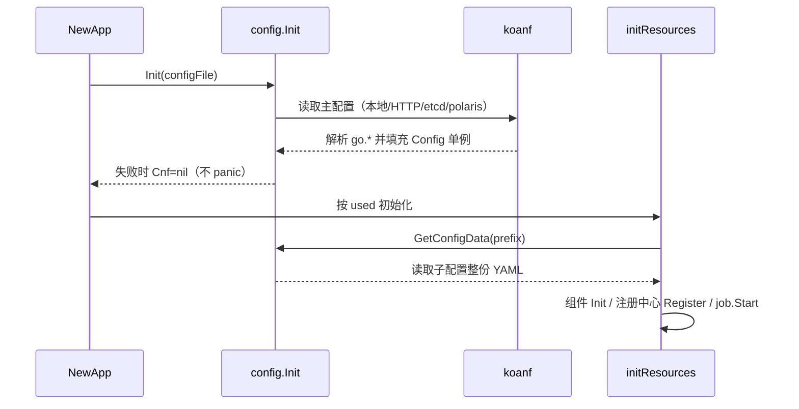

# 配置加载、刷新与诊断

## 1. 加载链路



要点：

- 主配置失败不会阻断进程启动，但 `GetConfig*` 全部返回零值，表现为「端口 0、used 空」。
- 子配置缺失时 `GetConfigData` 返回 nil，组件只打日志，不 panic。
- 加载是**一次性**的；运行期改文件不生效，必须重启或调用重载。

## 2. 动态刷新

### 2.1 启用

```yaml
go:
  config:
    reload:
      token: "a-long-random-secret"
```

令牌非空时注册：

```
PUT /cfg/reload
X-MGin-Reload-Token: <token>
# 或 Authorization: Bearer <token>
```

### 2.2 安全约束

1. 来源 IP 必须是 loopback、私网或链路本地地址（检查 `RemoteAddr`，**不信任** `X-Forwarded-For`）。
2. Token 必须等长且常量时间比较。
3. 失败返回 403/401，不泄露配置内容。

### 2.3 会发生什么

| 动作 | 是否执行 |
|------|----------|
| 重新读取主配置与子配置 | ✅ |
| 重新连接 MySQL/SQLite/MongoDB/Redis | ✅（旧的先关闭） |
| 重新注册注册中心 | ✅ |
| 重启 job 调度器 | ✅ |
| 重建 Gin 路由/中间件 | ❌ |
| 改变监听端口/证书 | ❌ |
| 更新 `App.name/version/i18n` 字段 | ❌ |

因此：改端口、改 JWT 密钥、改默认中间件开关必须重启。重载是**串行**的（`reloadMu`），并发调用会排队。

### 2.4 失败处理

- 新配置加载失败（`Cnf == nil`）：保留旧连接，返回错误，进程继续运行。
- 新配置加载成功但某组件连接失败：旧连接已关闭，该组件处于不可用状态，需修复后再次重载或重启。**重载前先在预发验证**。

## 3. 诊断清单

### 3.1 启动阶段

| 症状 | 确认方法 | 常见原因 |
|------|----------|----------|
| 端口是 0 / used 为空 | 日志中「读取配置文件:」路径 | 配置路径错误（`go run`）、YAML 缩进错误 |
| 组件未连接 | 日志「加载 X 失败，配置文件中未使用」 | `used` 拼写错误或子串不匹配 |
| 子配置读不到 | 检查 `<prefix>-<env>.yml` 是否存在 | `prefix`/`env` 不一致、`file` 模式路径不对 |
| 启动即 panic | 看 panic 栈 | `i18n.Init()` 失败、VictoriaLogs 配置非法 |
| 探针 404 | 访问 `/health/live` | 未开启 `EnableHealth`/`go.health.enabled` |

### 3.2 运行阶段

| 症状 | 确认方法 | 处置 |
|------|----------|------|
| 修改配置无效 | 是否调用了 `/cfg/reload` | 调重载；端口/中间件改动需重启 |
| 重载返回 500 | 响应中的错误信息 | 修复新配置后重试；必要时重启 |
| 重载后连接全断 | `/health/ready` 与日志 | 新配置数据源不可达；恢复后再次重载 |
| 配置中心不可达 | 启动日志中的 HTTP 错误 | 网络/凭据；切 `file` 模式兜底 |

### 3.3 快速验证片段

```bash
# 主配置是否被读到
grep -n "读取配置文件" app.log

# 重载
curl -s -X PUT localhost:8080/cfg/reload \
  -H "X-MGin-Reload-Token: $TOKEN"

# 依赖状态
curl -s localhost:8080/health/ready | jq .

# 当前生效的 used
grep -n "used" conf/application.yml
```

## 4. 配置变更流程建议

1. 本地/预发验证 YAML（可用 `go run` 前先 `yamllint`）。
2. 变更清单：新增键是否已在代码解析？默认值是否保持旧行为？
3. 生产变更：先备份当前配置；调用重载；观察 5 分钟指标与日志；异常则回滚配置并再次重载。
4. 结构性变更（端口、TLS、中间件）走发布流程，不做热重载。
