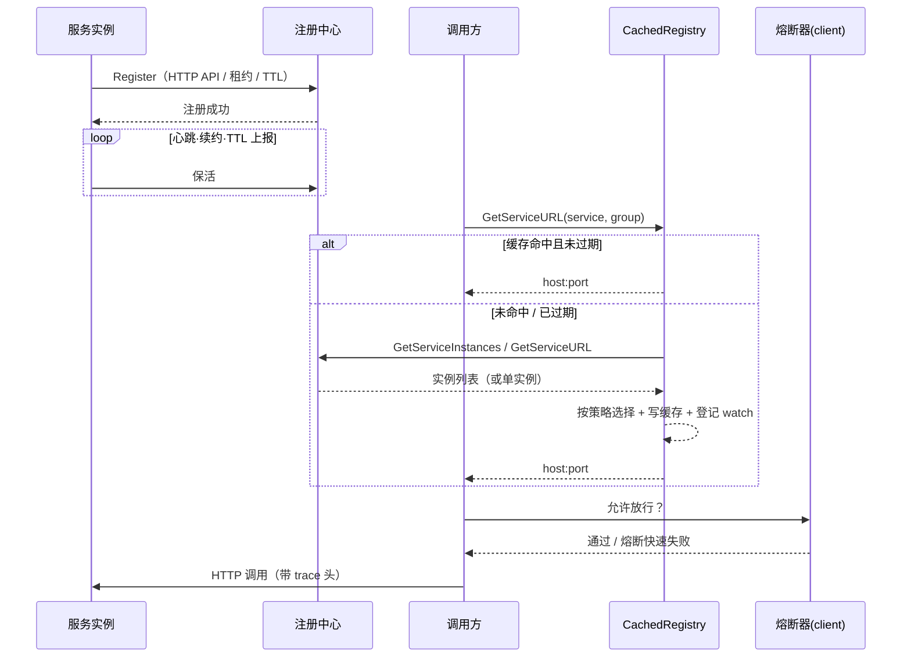

# 服务发现与负载均衡

## 1. 交互模型



两条独立的稳定性机制：

| 层 | 位置 | 作用 |
|---|---|---|
| 发现缓存与降级 | `registry.CachedRegistry` | 减少注册中心 RTT；注册中心抖动时复用上次成功实例 |
| 调用熔断与兜底 | `client.Call` | 连续失败后快速失败；可选返回上次成功响应 |

## 2. 接口契约

### 2.1 必需接口 `RegistryClient`

```go
package registry

var Registry RegistryClient // 全局单例，NewApp/Reload 时重建

type RegistryClient interface {
	Register(registryConfigData []byte)
	GetServiceURL(servicename string, groupName ...string) (string, string)
	DeRegister()
}
```

- `GetServiceURL` 返回 `host:port`（含 `http://`/`https://` 协议前缀）与最终命中的 group/namespace。
- 没有独立的健康检查方法：健康由各实现的心跳 / 租约 / TTL 维持。
- `groupName` 为变长参数：不传用后端默认分组，传空串等价于不传。

### 2.2 可选扩展接口

后端按能力实现，调用方用类型断言探测；未实现的调用方可退回 `GetServiceURL`：

```go
// 返回完整健康实例列表（含权重、元数据）
type InstanceProvider interface {
	GetServiceInstances(service string, group ...string) ([]ServiceInstance, string)
}

// 注册实例下线事件（供缓存层失效）
type OfflineSubscriber interface {
	SubscribeOffline(func(service, group string)) error
}

// 订阅指定服务的可用性变化，返回取消函数
type ServiceWatcher interface {
	WatchService(service, group string, callback func()) (cancel func(), err error)
}
```

统一结果模型：

```go
type ServiceInstance struct {
	URL      string            // 带协议前缀的 host:port
	Weight   int               // <=0 表示后端未提供权重
	Metadata map[string]string // 后端原始元数据，可为 nil
}
```

`registry.ServiceInstance` 是 `registry/model.ServiceInstance` 的类型别名，可直接互通。

### 2.3 空实现

`go.discovery.registry` 为空或取值未知时，`NewRegistry()` 返回 `noopRegistryClient`：

- `GetServiceURL` 恒返回 `("", "")`，`client.Call` 因此返回「微服务获取 X 服务主机IP端口失败」；
- `Register` / `DeRegister` 为空操作，不会 panic。

## 3. 四种实现能力对照

| 能力 | Nacos | Consul | etcd | Polaris |
|---|---|---|---|---|
| 注册方式 | HTTP `/nacos/v1/ns/instance` | Agent 注册 + TTL 检查 | 租约 Put（key 内直接存 URL） | 先建服务再注册实例 |
| 保活机制 | 5s 心跳，连续 3 次失败自动重注册 | TTL 30s，25s 上报 `HealthPassing`，`DeregisterCriticalServiceAfter=10m` | lease 10s + KeepAlive，通道关闭或续约失败自动重注册 | 依赖注册中心心跳/探活 |
| `GetServiceInstances` | ✅ 过滤 `!Healthy \|\| !Enabled \|\| Marked`，带 `Weight`、`Metadata` | ✅ 仅单 group，`Weight` 取自 tag `weight=N`，**不填 `Metadata`** | ✅ `Weight` 固定 1，**不填 `Metadata`** | ✅ 过滤 `!Healthy \|\| Isolate`，`Weight<=0` 归一为 1，带 `Metadata` |
| `SubscribeOffline` | ✅ 轮询降级 | ❌ 未实现 | ✅ 真实 `Watch(prefix)` 删除事件 | ✅ 轮询降级 |
| `WatchService` | ✅ 5s 轮询 + 边沿触发 | ✅ 5s 轮询 + 边沿触发 | ✅ 真实 watch，删除事件触发一次后退出 | ✅ 5s 轮询 + 边沿触发 |
| 多地址/多 endpoint | 单地址 | `server`/`port` 逗号分隔，逐个尝试 | 单地址 | `server` 逗号分隔，`GetServiceURL` 逐个递归 |
| SSL 表达 | `Metadata["ssl"]="true"` | tag[2] 存协议前缀 | key 的 value 直接是完整 URL | `Metadata["ssl"]="true"` + 实例端口改为 SSL 端口 |

补充说明：

1. **Consul 只支持单 group 查询**：`GetServiceURL` 会遍历 `groupName` 与所有 client，`GetServiceInstances` 仅取第一个 group。
2. **权重来源不同且当前都不可配**：Nacos 注册时写死 `weight=1`；Polaris 注册时发送客户端结构体的 `weight`（默认 0，读取时按 1 处理）；Consul 从 tag `weight=N` 解析但 `Register` 不写该 tag；etcd 的 value 只存 URL。因此 `weighted` 策略在不手工改注册中心权重时等价于随机。
3. **真实 watch 只有 etcd**：Nacos/Consul/Polaris 的 `SubscribeOffline`/`WatchService` 均为 5s 轮询 + 边沿触发（仅「可用 → 不可用」回调一次），下线感知最长延迟约 5s。
4. **Polaris 需要手动注册**：`initResources` 不包含 polaris 分支，必须由业务显式调用 `registry.Registry.Register(...)`（见 §4.4）。

## 4. 配置

### 4.1 发现总开关

```yaml
go:
  config:
    used: "nacos"          # 让框架加载子配置
    env: test              # 子配置文件后缀
    prefix:
      nacos: nacos         # → nacos-test.yml
  discovery:
    registry: nacos        # nacos / consul / etcd / polaris，留空=不注册不发现
    callType: json         # client.Call 协议默认值
    cacheTTL: 3            # 发现缓存秒数
    cacheRefresh: 1        # 热刷新秒数
```

| 键 | 默认 | 说明 |
|---|---|---|
| `go.discovery.registry` | 空 | 后端类型；空 → `noopRegistryClient` |
| `go.discovery.callType` | `x-form` | `client.Options.Protocol` 为空时使用 |
| `go.discovery.cacheTTL` | 60（秒） | 发现结果缓存；影响实例下线后的收敛时延 |
| `go.discovery.cacheRefresh` | 60（秒） | 后台热刷新间隔；`<=0` 时补 60 |
| `go.discovery.strategy` | `random` | `random` / `round_robin` / `weighted`，见 §6 |
| `go.discovery.circuitFailures` | 3 | 熔断失败阈值（`client.Call` 使用） |
| `go.discovery.circuitOpenWindow` | `30s` | 熔断打开后的探测窗口，支持 `30s` 或纯数字（秒） |

> `config.Init` 会把 `cacheTTL`/`cacheRefresh` 未配置或 `<=0` 的情况补成 60s；只有 `config.Config` 未初始化（`CachedRegistry` 拿不到配置）时，装饰器才用内置兜底 3s/1s。`application.example.yml` 示例给的是 3/1，按需选择。

### 4.2 Nacos

```yaml
# nacos-test.yml
go:
  nacos:
    server: 127.0.0.1
    port: 8848
    apiversion: v1        # 默认 v1
    clusterName: DEFAULT
    group: DEFAULT_GROUP
    username: ""          # 开启鉴权时填写
    password: ""
    lan: true             # 优先用内网地址注册
    lanNet: 192.168.      # 网段前缀，配合 lan
```

### 4.3 etcd / Consul

```yaml
# etcd-test.yml：key 形如 /{prefix}/{group}/{service}/{instance}，value 为完整 URL
go:
  etcd:
    server: 127.0.0.1
    port: 2379
    prefix: mgin              # 可为空，空则用根路径
    keyTemplate: ""           # 自定义 key 模板，空则用内置 {prefix}/{group}/{service}/{instance}
    group: DEFAULT_GROUP
    clusterName: DEFAULT
    username: ""              # 开启 etcd 鉴权时填写
    password: ""
    lan: false
```

```yaml
# consul-test.yml：port 为 Consul HTTP API 端口
go:
  consul:
    server: 127.0.0.1
    port: 8500
    token: ""
    group: DEFAULT_GROUP
    clusterName: DEFAULT
    lan: false
```

### 4.4 Polaris

```yaml
# polaris-test.yml
go:
  polaris:
    server: 127.0.0.1      # 多个用逗号分隔
    port: 8090             # 与 server 按序配对
    token: ""
    namespace: default
    lan: false
    lanNet: 192.168.
```

Polaris 未接入自动初始化，需要业务在启动时补一行：

```go
app := mgin.NewApp(...) // 完成后
registry.Registry.Register(config.Config.GetConfigData("polaris"))
```

前提是 `go.config.used` 含有 `polaris`，否则子配置不会被加载，`Register(nil)` 只会打印「配置错误」。

## 5. 本地缓存装饰器 `CachedRegistry`

`NewRegistry()` 对四种后端统一套一层 `CachedRegistry`，对调用方完全透明。

| 能力 | 行为 |
|---|---|
| TTL 缓存 | 以 `服务名 + groupName` 为 key；命中即返回，零注册中心 RTT |
| singleflight | 回退到后端 `GetServiceURL` 的路径上，同一 key 的并发现只回源一次，其余等待复用结果 |
| 后台热刷新 | 每 `cacheRefresh` 刷新 `cacheTTL` 内被访问过的 key，顺带轮换实例 |
| 降级 | 回源为空但有旧缓存时，延长旧缓存并打 Warn，调用继续可用 |
| 空结果不缓存 | 确认无实例时不写缓存，下次立即回源 |
| 事件失效 | 后端实现 `OfflineSubscriber` 时自动订阅，回调 `Invalidate(service, group)` |
| 按 key watch | 每个发现过的 key 登记一次 `WatchService`，可用性下降时精确失效 |
| 关闭 | `DeRegister()` 停止刷新协程、取消所有 watch、清空缓存，再转交后端注销 |

注意事项：

- `CachedRegistry.GetServiceInstances` 会**再套用一次选择策略**，因此返回的通常是 1 条记录。需要全量列表时，请直接持有并调用具体后端（如 `&etcd.EtcdClient{}`），或自行做缓存。
- 实例下线后最长 `cacheTTL` + `cacheRefresh` 内仍可能被调用；需要更快收敛时调小两个值。
- 缓存与 watch 都是进程内的，多副本部署时各自独立，不做共享。

## 6. 选择策略

策略在 `CachedRegistry` 内应用，配置项 `go.discovery.strategy`：

| 值 | 行为 |
|---|---|
| `random`（默认） | 从实例列表中随机取一个 |
| `round_robin` | 进程内自增序号取模，按列表顺序轮转 |
| `weighted` | 以 `Weight`（`<=0` 视为 1）为权重做加权随机 |

不设置时各后端本身也会随机取一个实例，因此 `random` 只是显式化。`round_robin`/`weighted` 依赖后端实现 `InstanceProvider` 并返回多实例；四个内置后端都实现了，但权重目前都为 1（见 §3 补充说明第 2 条），所以 `weighted` 实际退化为随机。未实现 `InstanceProvider` 的自定义后端会走 `GetServiceURL` 单实例回退。

> 注意执行顺序：`GetServiceURL` 命中 `InstanceProvider` 时直接返回，不走 singleflight；只有实例列表为空、回退调用后端 `GetServiceURL` 时才做并发合并。

## 7. 负载均衡在哪里

- 实例选择发生在 **`CachedRegistry`（策略）** 与 **后端实现内部（随机）**，两者串联。
- `client` 不做加权、最少连接等策略；旧版 `client` 内的加权随机逻辑已废弃（相关代码保留为注释）。
- 灰度/权重优先在注册中心侧配置实例权重（Nacos/Polaris），或由网关完成。

## 8. 多环境与多注册中心

- 一个进程只使用一个注册中心（`go.discovery.registry` 单值）。
- 跨集群调用：让调用方与目标服务注册到同一注册中心、同一 group/namespace。
- 单元化/多区域：当前没有就近路由，需要在注册中心元数据或网关层实现。

## 9. 排障

| 症状 | 原因 | 确认 | 处置 |
|---|---|---|---|
| 「服务注册中心未初始化」 | `registry.Registry` 为 nil | 是否走了 `NewApp`/`mgin.Init` | 用框架启动或手动赋值 |
| 「微服务获取 X 服务主机IP端口失败」 | 未配置 registry、服务名/分组不匹配、实例未注册 | `go.discovery.registry`、注册中心控制台 | 校正配置或服务名 |
| 刚下线仍被调用 | 本地缓存未过期 | 看 `cacheTTL`/`cacheRefresh` | 调小 TTL；下游幂等 |
| 注册的 IP 不可达 | 多网卡/容器网络 | 控制台看实例 IP | 配 `go.application.ip` |
| etcd 实例被摘除后不恢复 | 网络抖动导致续约失败 | 日志中是否有 reRegister 记录 | 检查 2379 连通性；必要时加退避 |
| Consul 查不到实例 | TTL 上报失败被标记 critical | Consul UI 中实例健康状态 | 检查 8500 与 `passTTL` 日志 |
| Polaris 注册成功但调用不到 | namespace 不一致或未手动注册 | 查 namespace / 启动日志 | 统一配置并显式 `Register` |
| 大量「circuit breaker is open」 | 下游连续失败触发熔断 | 看下游健康与 `circuitFailures` | 修复下游；或调大阈值/窗口 |
