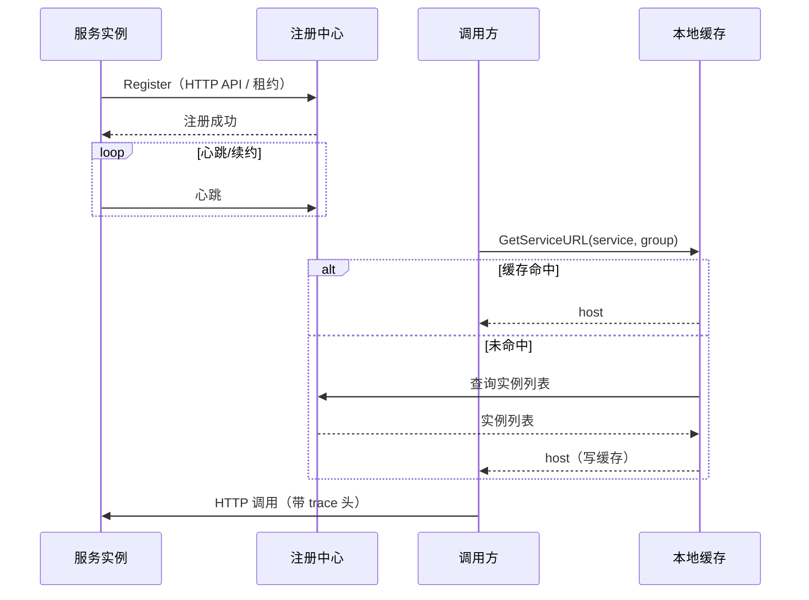

# 服务发现与负载均衡

## 1. 交互模型



统一接口（`registry`）：

```go
type RegistryClient interface {
	Register(registryConfigData []byte)
	GetServiceURL(servicename string, groupName ...string) (string, string)
	DeRegister()
}
```

没有独立的健康检查方法：健康由各实现的心跳/租约/TTL 维持。

## 2. 四种实现

| 实现 | 注册方式 | 健康机制 | 关键配置 |
|------|----------|----------|----------|
| Nacos | HTTP `/nacos/v1/ns/instance` | 5s 心跳，连续 3 次失败自动重注册 | `go.nacos.{server,port,group,apiversion,clusterName}` |
| Consul | Agent 注册 | TTL 30s，25s 更新；`DeregisterCriticalServiceAfter=10m` | `go.consul.{server,port,group}` |
| etcd | 租约 + keepAlive | 租约 10000s，失败重注册 | `go.etcd.{server,port,prefix,group}` |
| Polaris | 先建服务再注册实例 | 心跳 | `go.polaris.{server,port,token,namespace}`，**需手动 Register** |

启用：`go.config.used` 含对应组件 + `go.discovery.registry` 指定类型。

```yaml
go:
  config:
    used: "nacos"
    prefix: { nacos: nacos }
  discovery:
    registry: nacos
```

> Polaris 是例外：`initResources` 没有 polaris 分支，需业务在启动时显式调用
> `registry.Registry.Register(config.Config.GetConfigData("polaris"))`。

## 3. 本地缓存装饰器

`NewCachedRegistry` 包装所有实现：

| 能力 | 行为 |
|------|------|
| TTL 缓存 | `go.discovery.cacheTTL`（默认 60s） |
| 并发合并 | 同一服务并发查询只打一次注册中心（singleflight） |
| 后台热刷新 | 每 `cacheRefresh` 刷新近期访问过的服务，轮换实例 |
| 降级 | 注册中心无实例/报错时复用旧缓存并打 Warn |

**影响**：实例下线后最长 `cacheTTL` 内仍可能被调用；需要更快收敛时调小 TTL，或在下游做幂等。

## 4. 负载均衡在哪里

- 选择发生在**注册中心实现内部**：Nacos/etcd/Polaris 随机取一个实例；Consul 使用 `passingOnly` 过滤后随机。
- `client` **不做**加权、最少连接等策略；旧版 `client` 内的加权随机逻辑已废弃。
- 因此：如需灰度/权重，需要在注册中心侧（实例权重/元数据）或网关侧实现，框架不提供。

## 5. 多环境与多注册中心

- 一个进程只使用一个注册中心（`go.discovery.registry` 单值）。
- 跨集群调用：让调用方与目标服务注册到同一注册中心/同一 group；`client.Options.Group` 可指定 Nacos 分组。
- 单元化/多区域：当前没有就近路由，需要在注册中心元数据或网关层实现。

## 6. 排障

| 症状 | 原因 | 确认 | 处置 |
|------|------|------|------|
| 调用报「服务注册中心未初始化」 | `registry` 未配置 | 查 `go.discovery.registry` | 配置并重启 |
| 调用报「获取主机IP端口失败」 | 服务名/分组不匹配，或实例未注册 | 注册中心控制台查询 | 校正服务名或分组 |
| 刚下线仍被调用 | 本地缓存未过期 | 看 `cacheTTL` | 调小 TTL / 下游幂等 |
| 注册的 IP 不可达 | 多网卡/容器网络 | 控制台看实例 IP | 配 `go.application.ip` |
| Polaris 注册成功但调用不到 | 命名空间/分组不一致 | 查 namespace | 统一配置 |
