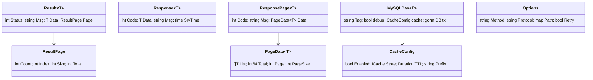

# 类型定义

按包列出对外类型、字段与嵌套关系。未导出类型（如 `config.config`）通过全局单例访问，不能直接构造。

---

## 1. `models`

### `Result[T]`

业务接口统一返回。

| 字段 | 类型 | JSON | 说明 |
|------|------|------|------|
| `Status` | `int` | `status` | 业务码：1 成功；1000+ 见错误码 |
| `Msg` | `string` | `msg` | 文案（i18n 翻译后） |
| `Data` | `T` | `data,omitempty` | 数据 |
| `Page` | `*ResultPage` | `page,omitempty` | 分页信息 |

### `ResultPage`

| 字段 | 类型 | JSON | 说明 |
|------|------|------|------|
| `Count` | `int` | `count` | 当前页条数 |
| `Index` | `int` | `index` | 页码（从 1 开始） |
| `Size` | `int` | `size` | 每页大小 |
| `Total` | `int` | `total` | 总条数 |

### `PostLog`

接口日志（MongoDB 文档）。

| 字段 | 类型 | JSON | 说明 |
|------|------|------|------|
| `Time` | `string` | `time` | 请求时间（格式化字符串） |
| `RequestId` | `string` | `requestId` | 链路 ID |
| `ResponseTime` | `string` | `responseTime` | 耗时（毫秒的字符串形式） |
| `TTL` | `int` | `ttl` | 业务自定义 |
| `AppName` | `string` | `appName` | 应用名 |
| `Apiname` | `string` | `apiName` | 接口名（字段名大小写以源码为准） |
| `Method` | `string` | `method` | HTTP 方法 |
| `ContentType` | `string` | `contentType` | 请求类型 |
| `Uri` | `string` | `uri` | 路径 |
| `ClientIP` | `string` | `clientIP` | 客户端 IP |
| `RequestHeader` | `map[string]string` | `requestHeader` | 请求头 |
| `RequestParam` | `any` | `requestParam` | query |
| `RequestBody` | `any` | `requestBody` | body |
| `ResponseStr` | `string` | `responseStr` | 响应文本 |
| `ResponseMap` | `any` | `responseMap` | 响应映射 |

### `Timestamp`

`type Timestamp time.Time`，用于需要自定义 JSON 时间格式的模型字段；实现 `MarshalJSON/UnmarshalJSON/Value/Scan`。

---

## 2. `models/vo`

### `Response[T]`

跨服务调用返回（新协议）。

| 字段 | 类型 | JSON |
|------|------|------|
| `Code` | `int` | `code` |
| `Data` | `T` | `data` |
| `Msg` | `string` | `msg` |
| `SrvTime` | `time.Time` | `srvTime` |

### `ResponsePage[T]`

| 字段 | 类型 | JSON |
|------|------|------|
| `Code` | `int` | `code` |
| `Msg` | `string` | `msg` |
| `SrvTime` | `time.Time` | `srvTime` |
| `Data` | `*PageData[T]` | `data` |

### `PageData[T]`

| 字段 | 类型 | JSON |
|------|------|------|
| `List` | `[]T` | `list` |
| `Total` | `int64` | `total` |
| `Page` | `int` | `page` |
| `PageSize` | `int` | `pageSize` |

---

## 3. `client`

### `Options`

| 字段 | 类型 | 默认 | 说明 |
|------|------|------|------|
| `Method` | `string` | POST | HTTP 方法 |
| `Protocol` | `string` | `go.discovery.callType` | `x-form`/`json`/`restful`/`file` |
| `Group` | `string` | 空 | 服务分组 |
| `Header` | `map[string]string` | 空 | 追加请求头 |
| `Query` | `map[string]string` | 空 | query 参数 |
| `Data` | `map[string]string` | 空 | 表单字段 |
| `Json` | `any` | nil | JSON body |
| `Path` | `map[string]string` | 空 | `{key}` 路径替换 |
| `Files` | `[]grequests.FileUpload` | 空 | 文件；非空强制 file |
| `Retry` | `bool` | false | 失败重试一次 |

---

## 4. `db/dao`

### `Dao[E]`

```go
type Dao[E any] interface {
    Insert(entity *E) error
}
```

只有 `MgoDao` 满足（`MySQLDao` 为 `Create`）。

### `MySQLDao[E schema.Tabler]`

| 字段 | 类型 | 说明 |
|------|------|------|
| `Tag` | `func() string` | 缓存 key 的标签段（导出） |
| `debug` | `bool` | SQL 调试（未导出） |
| `ctx` | `*context.Context` | 上下文（未导出，`WithContext` 写入） |
| `cache` | `*CacheConfig` | 缓存配置（未导出） |
| `tx` | `*gorm.DB` | 事务连接（未导出） |

### `MgoDao[E any]`

| 字段 | 类型 | 说明 |
|------|------|------|
| `CollectionName` | `string` | **必须手动赋值**，空则所有方法报错 |
| `Tag` | `func() string` | 缓存标签 |

### `QueryOption`

| 字段 | 类型 | 说明 |
|------|------|------|
| `Preloads` | `[]string` | 预加载关联 |
| `OrderBy` | `[]string` | 排序，如 `created_at desc` |

### `CacheConfig`

| 字段 | 类型 | 说明 |
|------|------|------|
| `Enabled` | `bool` | 开关 |
| `Store` | `cacheStore.ICache` | 缓存实现 |
| `TTL` | `time.Duration` | 过期时间；**0 = 永久** |
| `Prefix` | `string` | key 前缀，默认 `mgin:mysql:` |

### `RedisCache`

实现 `ICache`，方法：`Add/Value/IsExist/Clear/Get/Set/Range/Delete/Close`。`Clear=FLUSHDB`、`Range` 全库 SCAN。

---

## 5. `cache`

### `ICache`

9 个方法：`Add(key, value any, lifeSpan time.Duration)`、`Value(key any) (any, bool)`、`IsExist`、`Clear() bool`、`Get`、`Set(key, value any, duration time.Duration)`、`Range(func(key, value any) bool)`、`Delete`、`Close`。

### `MemCache` / `DiskCache`

| 类型 | 字段（未导出） | 特性 |
|------|----------------|------|
| `MemCache` | items、过期清理 | 深拷贝值、无容量上限 |
| `DiskCache` | bitcask 实例 | 跨进程、值序列化为 string |

`Cache` 是内部组合类型，不直接使用。

---

## 6. `registry`

### `RegistryClient`

```go
type RegistryClient interface {
    Register(registryConfigData []byte)
    GetServiceURL(servicename string, groupName ...string) (string, string)
    DeRegister()
}
```

### `CachedRegistry`

字段未导出；行为见 [服务发现](../05-governance/01-discovery-and-load-balancing.md#3-本地缓存装饰器)。

---

## 7. `logsink`

### `Entry`

`type Entry = models.PostLog`（类型别名）。

### `Record`

| 字段 | 类型 | JSON |
|------|------|------|
| `Data` | `[]byte` | `-` |
| `Time` | `string` | `time` |
| `Level` | `string` | `level` |
| `Message` | `string` | `message` |
| `App` | `string` | `app` |
| `RequestID` | `string` | `request_id` |
| `GoroutineID` | `uint64` | `goroutine_id` |
| `Package` | `string` | `package` |
| `File` | `string` | `file` |
| `Function` | `string` | `function` |
| `Line` | `int` | `line` |

### `Handler` / `RecordHandler`

```go
type Handler interface {
    Name() string
    Write(entry *Entry) error
}
type Closer interface { Close() error }
type RecordHandler interface {
    Name() string
    Write(*Record) error
}
```

### `Options` / `Option`

| 字段 | 类型 | 默认 | 说明 |
|------|------|------|------|
| `QueueSize` | `int` | 1024 | `<=0` 或 `>1024` 时取默认 |
| `Workers` | `int` | 1 | 兼容字段，实际固定 1 |

`Option`：`WithQueueSize(n)`、`WithWorkers(n)`（后者不改变实际协程数）。

### `HandlerStats`

| 字段 | 类型 | 说明 |
|------|------|------|
| `Name` | `string` | handler 名 |
| `Queued` | `int` | 当前队列长度 |
| `Dropped` | `uint64` | 因队列满淘汰的数量 |
| `Written` | `uint64` | 成功写入数 |
| `Failed` | `uint64` | 写入失败数 |

`Stats() []HandlerStats` 按注册顺序返回。

---

## 8. `job`

### `JobInfo`（表 `mgin_job_info`）

| 字段 | 类型 | 说明 |
|------|------|------|
| `ID` | `int64` | 主键 |
| `JobName` | `string` | 全局唯一 |
| `JobGroup` | `string` | 默认 `DEFAULT` |
| `Description` | `string` | 描述 |
| `ScheduleType` | `string` | `cron/fixed_rate/fixed_delay/once` |
| `ScheduleConf` | `string` | 表达式/间隔 |
| `HandlerName` | `string` | 对应 `job.Register` 名 |
| `JobParam` | `map[string]interface{}` | JSON 序列化存 text |
| `Timeout` | `int` | 秒，0 不限 |
| `RetryCount` / `RetryInterval` | `int` | 重试次数/间隔 |
| `BlockStrategy` | `string` | `serial/discard/concurrent/cover` |
| `MisfireStrategy` | `string` | `do_nothing/fire_now` |
| `Status` | `int` | 1 运行 / 0 停止 |
| `LastFireTime` / `NextFireTime` | `*time.Time` | 调度时间 |
| `TriggerCount` / `SuccessCount` / `FailCount` | `int64` | 统计 |
| `Remark` | `string` | 备注 |
| `CreateAt` / `UpdateAt` | `time.Time` | 时间戳 |

### `JobLog`（表 `mgin_job_log`）

字段：`ID`、`JobId`、`JobName`、`JobGroup`、`HandlerName`、`JobParam`、`TriggerType`、`Status`、`StartAt`、`EndAt`、`CostMs`、`RetryNum`、`Message`、`LogDetail`、`Hostname`、`CreateAt`。

### `Context`

| 字段 | 类型 | 说明 |
|------|------|------|
| `JobId` | `int64` | 任务 ID |
| `JobName` / `JobGroup` / `HandlerName` | `string` | 标识 |
| `Param` | `map[string]interface{}` | 任务参数 |
| `LogId` | `int64` | 本次执行日志 ID |
| `TriggerType` | `string` | 定时/手动 |
| `RetryNum` | `int` | 当前重试次数 |

方法：`Log(format string, args ...any)` 写入执行日志明细。

### `HandlerFunc`

`func(ctx *Context) error`。返回 error 触发重试（按 `RetryCount`）并记录失败。

---

## 9. `middleware`

### `ratelimit.Rule`

| 字段 | 类型 | 说明 |
|------|------|------|
| `Name` / `Path` / `Methods` | string/string/[]string | 匹配条件；`Path` 支持精确、`/*` 前缀、`:param` |
| `Algorithm` | `Algorithm` | 默认 `token_bucket` |
| `Dimension` | `Dimension` | 默认 `global` |
| `HeaderKey` | `string` | `dimension=header` 时的头名 |
| `Rate` / `Burst` / `Window` / `WindowMs` | float64/int | 速率、突发、窗口 |
| `MaxConcurrent` | int | 并发上限 |
| `Wait` / `WaitTimeoutMs` | bool/int | 是否排队等待 |
| `Code` / `Message` / `HttpStatus` | int/string/int | 拒绝时的响应 |

### `ratelimit.Config`

| 字段 | 类型 | 说明 |
|------|------|------|
| `Enabled` | `bool` | 是否启用 |
| `Whitelist` | `[]string` | 路径前缀白名单 |
| `WhiteIps` | `[]string` | IP 白名单 |
| `IdleTimeout` | `int` | 空闲回收（秒），默认 600 |
| `Headers` | `bool` | 是否输出 `X-RateLimit-*` 响应头 |
| `Rules` | `[]Rule` | 独立规则列表（未导出字段保存全局规则） |

### `xss.XssMw`

| 字段 | 类型 | 说明 |
|------|------|------|
| `FieldsToSkip` | `[]string` | 跳过滤字段（`password` 默认跳过） |
| `Policies` | — | `xss.StrictPolicy` / `xss.UGCPolicy` |

### `session.Config`

| 字段 | 类型 | 默认 |
|------|------|------|
| `ErrorHandleFunc` | `func(*gin.Context, error)` | 500 + `models.Error` |
| `StoreKey` / `ManageKey` | `string` | gin-session 默认键 |
| `Skipper` | `func(*gin.Context) bool` | 不跳过 |

---

## 10. `casbin`

### `CasbinInfo`

| 字段 | 类型 | 说明 |
|------|------|------|
| `Path` | `string` | 资源路径（支持 `keyMatch2`） |
| `Method` | `string` | HTTP 方法 |

---

## 11. 嵌套关系



---

## 12. 可直接运行的示例

```go
package main

import (
	"context"
	"fmt"
	"time"

	"github.com/maczh/mgin/cache"
	"github.com/maczh/mgin/db/dao"
	"github.com/maczh/mgin/models"
	"github.com/maczh/mgin/models/vo"
)

type User struct {
	Id   int64  `gorm:"column:id;primaryKey"`
	Name string `gorm:"column:name"`
}

func (User) TableName() string { return "user" }

func main() {
	// models.Result
	r := models.Result[User]{
		Status: 1, Msg: "success",
		Data: User{Id: 1, Name: "alice"},
		Page: &models.ResultPage{Count: 1, Index: 1, Size: 20, Total: 1},
	}
	fmt.Printf("%+v\n", r)

	// vo.Response
	resp := vo.Response[User]{Code: vo.SUCCESS, Msg: "success", Data: User{Id: 1}}
	fmt.Printf("%+v\n", resp)

	// DAO + 缓存配置
	mem := cache.OnMemCache("demo")
	d := &dao.MySQLDao[User]{}
	d.WithCache(dao.CacheConfig{
		Enabled: true, Store: mem,
		TTL: 30 * time.Second, Prefix: "demo:",
	})
	d.WithContext(ptr(context.Background()))
	fmt.Println("dao configured")
}

func ptr[T any](v T) *T { return &v }
```

> `WithContext` 会修改 DAO 自身；示例中新建了 `d`，不要跨请求复用同一个实例再改 ctx。
