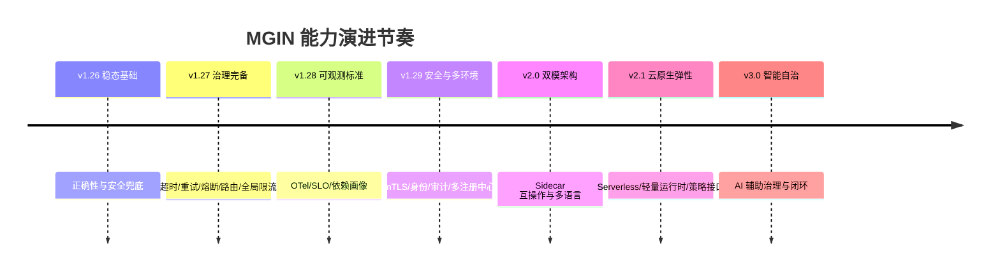
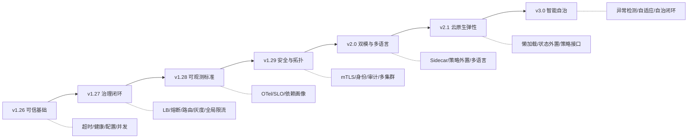

# MGIN 演进路线图（v1.26 → v3.0）

| 项 | 内容 |
|----|------|
| 适用范围 | `jh` 分支（模块 `github.com/maczh/mgin`，基线 `v1.25.27-jh`） |
| 文档性质 | 能力规划，不包含实现方案与操作步骤 |
| 读者 | 架构师、技术负责人、框架维护者、平台团队 |
| 关联 | [能力现状](../02-concepts/04-requirements.md) · [已知问题](../11-appendix/03-migration-and-known-issues.md) · [架构决策](../02-concepts/03-design-decisions.md) |

> 本文回答三个问题：行业已经做到什么、MGIN 现在缺什么、未来几个大版本按什么顺序补。所有「现状」判断均以当前代码为准；「规划」只描述要建成什么能力，不规定用什么技术实现。

---

## 1. 分析框架

### 1.1 能力域划分

采用与主流微服务框架可对齐的八个能力域，避免按代码包划分导致视角碎片化：

| 域 | 覆盖内容 |
|----|----------|
| A. 服务注册与发现 | 注册、发现、健康、元数据、多集群 |
| B. 配置中心 | 配置模型、版本、灰度、校验、动态生效 |
| C. 服务治理 | 负载均衡、路由、超时、重试、熔断、限流、降级、隔离 |
| D. 可观测性 | 指标、日志、追踪、事件、SLO |
| E. 安全与身份 | 认证、授权、传输安全、密钥、审计 |
| F. 多语言与互操作 | 多语言 SDK、协议标准化、跨运行时互通 |
| G. 运行时与部署形态 | 库模式、Sidecar、Serverless、弹性 |
| H. 平台化与自治 | 控制面、策略即代码、AI 辅助、成本与容量 |

### 1.2 成熟度分级

| 级别 | 定义 | 判定标准 |
|------|------|----------|
| L0 缺失 | 无能力 | 代码中无对应实现 |
| L1 可用 | 能完成基本任务 | 单一实现、无治理策略、无标准化输出 |
| L2 完备 | 覆盖主要场景 | 多策略可选、有默认值与边界约束、有测试 |
| L3 体系化 | 可运营、可度量、可演进 | 有度量、有灰度、有兼容策略、有故障隔离 |
| L4 自治 | 自适应与闭环 | 策略自动调优、异常自愈、成本可优化 |

当前 MGIN 总体处于 **L1–L2 之间**：基础件齐全，但治理策略、标准化输出与运营闭环不足。

---

## 2. 行业能力基线

| 能力域 | 主流框架/平台水位 | 关键能力项 | MGIN 对照 |
|--------|-------------------|------------|-----------|
| 注册发现 | L3 | 多注册中心、元数据路由、健康分级、就近访问 | 多实现但单选、无元数据路由、无就近 |
| 配置中心 | L3 | 版本化、灰度发布、变更审计、Schema 校验、回滚 | 能读能重载，无版本/灰度/校验/审计 |
| 服务治理 | L3 | 全链路超时、重试预算、熔断、隔离、标签路由、灰度 | 有限流与 IP/并发限制，缺超时/熔断/路由 |
| 可观测 | L3 | OTel 标准、Trace/Metrics/Logs 关联、SLO、告警 | 有指标与日志，无 Trace 标准与 SLO |
| 安全 | L3 | mTLS、身份、细粒度授权、密钥轮换、审计 | JWT + Casbin + XSS，无 mTLS/轮换/审计 |
| 多语言 | L3 | 多语言 SDK 或 Sidecar 透明代理 | 仅 Go；i18n 是文案国际化，不等同多语言 SDK |
| 部署形态 | L3 | 库/Sidecar 双模、Serverless、弹性伸缩 | 仅库模式，启动与初始化偏重 |
| 平台化 | L2–L3 | 控制面、策略下发、AI 辅助排障 | 无控制面，配置即策略的雏形 |

> 结论：MGIN 的短板不在「有没有」，而在「策略是否完备、输出是否标准、能否被平台统一运营」。

---

## 3. 趋势研判与对 MGIN 的含义

| 趋势 | 行业表现 | 对 MGIN 的含义 | 应对策略 |
|------|----------|----------------|----------|
| 服务网格融合 | Sidecar/Ambient 模式承接流量治理，应用侧只保留业务与少量治理 | 不必自建数据面；要让库模式与网格共存，避免重复治理 | 双模架构：SDK 与 Sidecar 二选一或混合，治理策略可外置 |
| Serverless 化 | 按需伸缩、缩容到零、冷启动敏感、状态外置 | 重初始化（配置/数据源/注册）会放大冷启动 | 轻量运行时档位：懒加载、可裁剪初始化、快速就绪 |
| AI 辅助治理 | 异常检测、根因分析、容量与限流参数推荐 | 先要有高质量治理数据与标准接口，才谈得上智能 | 数据先行：统一治理事件模型 + 指标/追踪标准化 |
| 云原生标准化 | OTel、W3C TraceContext、Gateway API、SPIFFE、xDS | 自定义协议与私有指标会被平台拒之门外 | 输出标准化：追踪、指标、身份、策略接口对齐标准 |
| 平台工程 | 内部开发者平台统一配置、发布、观测 | 框架要提供机器可读的能力清单与策略接口 | 能力目录化：能力声明、版本矩阵、策略 Schema |
| 多运行时/多语言 | 同一业务混用 Go/Java/Python，Sidecar 承担通用能力 | Go SDK 无法覆盖全部语言 | 以 Sidecar 作为多语言答案，SDK 只做 Go 最优路径 |

---

## 4. 现状盘点（以代码为准）

图例：✅ 已具备　◐ 部分具备　✗ 缺失

| 能力项 | 状态 | 说明 |
|--------|------|------|
| Nacos/Consul/etcd/Polaris 注册发现 | ✅ | 四种实现，统一接口 |
| 发现结果本地缓存 | ✅ | TTL + singleflight + 热刷新 + 降级 |
| 多注册中心并存 | ✗ | 单值 `go.discovery.registry` |
| 实例元数据路由/就近访问 | ✗ | 仅按服务名 + 分组 |
| 负载均衡策略 | ◐ | 由注册中心实现随机选择；无权重/最少连接/一致性哈希 |
| 配置本地/HTTP/Nacos/Consul/etcd/Polaris | ✅ | 单一来源 |
| 配置热重载 | ◐ | 仅资源级；不重建路由/端口 |
| 配置版本、灰度、审计、Schema 校验 | ✗ | 无 |
| 统一响应与错误码 | ✅ | `models.Result` + `errcode` |
| 国际化文案 | ✅ | 数据库字典 + `X-Lang` |
| 请求超时（服务端/客户端） | ✗ | 客户端无超时；服务端未形成统一超时策略 |
| 重试预算/退避 | ◐ | 单次重试，无预算与退避 |
| 熔断/隔离/降级 | ✗ | 无内置 |
| 限流 | ◐ | 三种算法、五种维度，但仅进程内 |
| 标签路由/灰度/权重 | ✗ | 无 |
| 指标 | ◐ | 有 HTTP/构建/插件指标；HTTP 指标需手动挂中间件 |
| 日志 | ✅ | 运行/接口/调用三类，队列与多目标 |
| 分布式追踪 | ✗ | 仅 request id 透传，无 Span/OTel |
| SLO/告警规则 | ✗ | 无 |
| JWT 认证 | ◐ | 仅 HMAC，401 无响应体 |
| Casbin 授权 | ◐ | 每请求加载策略，多库不可用 |
| XSS/IP/并发限制 | ✅ | 基础防护 |
| mTLS/身份/密钥轮换 | ✗ | 依赖外部 |
| 多语言 SDK | ✗ | 仅 Go |
| 库模式 | ✅ | 单二进制 + 配置 |
| Sidecar/网格互操作 | ✗ | 无 |
| Serverless 友好（快速启动/懒加载） | ✗ | 启动即初始化全部 `used` 组件 |
| 定时任务 | ◐ | 单机调度，无分布式协调 |
| 脚手架 | ✅ | 可生成可编译工程（postgres/clickhouse 除外） |
| 控制面/策略下发 | ✗ | 配置即策略的雏形 |
| 能力目录/兼容矩阵 | ✗ | 文档有，机器不可读 |

---

## 5. 差距分析：十个必须补齐的能力

按「不补会阻碍后续演进」排序：

| # | 差距 | 后果 | 归属版本 |
|---|------|------|----------|
| 1 | 客户端/服务端超时缺失 | 故障放大、协程耗尽，治理无从谈起 | v1.26 |
| 2 | 健康检查失真（Redis 恒成功） | 探针不可信，K8s 与网关误判 | v1.26 |
| 3 | 配置无校验/版本/审计 | 配置事故高发，无法回滚 | v1.26 |
| 4 | 治理策略单一（无限流全局/路由/熔断） | 无法支撑灰度与故障隔离 | v1.27 |
| 5 | 限流仅进程内 | 多副本配额失效 | v1.27 |
| 6 | 无分布式追踪标准 | 跨服务排障靠日志拼凑 | v1.28 |
| 7 | 指标未覆盖依赖与业务闭环 | 无法做 SLO 与容量规划 | v1.28 |
| 8 | 安全缺 mTLS/密钥轮换/审计 | 无法通过合规评审 | v1.29 |
| 9 | 仅库模式、启动重 | 无法与网格共存、不适合弹性场景 | v2.0 / v2.1 |
| 10 | 无治理数据模型与策略接口 | AI 辅助与平台化没有输入 | v2.1 起铺垫，v3.0 成型 |

---

## 6. 演进原则与节奏

### 6.1 原则

1. **正确性优先于新能力**：探针、超时、并发安全类缺陷必须在功能扩张前解决。
2. **标准化输出优先于自研协议**：凡有事实标准（OTel/W3C/SPDX/xDS）的，不自造。
3. **双模而非替代**：库模式保留 Go 最优路径；Sidecar 模式承接多语言与网格。
4. **策略与执行分离**：治理策略可来自配置、控制面或网格，执行层保持统一语义。
5. **向后兼容**：默认关闭新能力；配置键与导出 API 只增不改。
6. **可度量**：每个版本必须有可验证的退出指标，而非「功能上线」即完成。

### 6.2 版本节奏

以 6 个月为一个大版本窗口、3 个月为一个 minor 窗口；每个版本先冻结、再验证、后发布（沿用现行发布规范）。

---

## 7. 版本路线图

### v1.26 · 稳态基础（Foundation Hardening）

**阶段目标**：让现有能力「可信、可测、可回滚」。不新增面向业务的卖点能力。

| 优先级 | 能力建设 | 预期体系能力 |
|--------|----------|--------------|
| P0 | 全链路超时语义（服务端读写、客户端调用、依赖检查） | 故障可预期，不再无限等待 |
| P0 | 健康检查真实性（Redis/Mongo/MySQL 一致语义、依赖分级） | 探针可作为 K8s/网关唯一事实来源 |
| P0 | 配置校验与版本化（Schema、变更审计、可回滚） | 配置事故可控、可追溯 |
| P0 | 并发安全与资源生命周期（DAO 上下文、缓存边界、关闭顺序） | 高并发下行为确定 |
| P1 | 安全基线（JWT 依赖替换、密钥最小化、错误响应规范） | 通过基础安全评审 |
| P1 | 质量门禁（构建/测试/兼容性矩阵自动化） | 每次变更可回归 |
| P2 | 脚手架能力纠偏（数据层声明与实现一致） | 生成即正确 |

**退出标准**：探针与超时行为有测试；配置变更可回滚；`go build`/核心测试/兼容矩阵纳入门禁；已知高危缺陷清零。

**趋势对应**：云原生标准化的前置条件——没有可信的健康与超时，标准化输出没有意义。

---

### v1.27 · 治理完备（Governance Complete）

**阶段目标**：把「能调用」升级为「可控调用」，形成治理闭环。

| 优先级 | 能力建设 | 预期体系能力 |
|--------|----------|--------------|
| P0 | 负载均衡策略族（随机/轮询/权重/最少连接/一致性哈希） | 按场景选择流量分布 |
| P0 | 重试预算与退避、幂等约束 | 重试不再放大故障 |
| P0 | 熔断与隔离（按服务/实例/接口） | 故障不扩散 |
| P0 | 标签路由与灰度（元数据、权重、按比例） | 支持金丝雀与多版本共存 |
| P1 | 全局限流（跨副本配额）与配额治理 | 多副本下配额有效 |
| P1 | 降级策略（缓存兜底、静态兜底、快速失败） | 弱依赖故障不拖垮主链路 |
| P1 | 多注册中心与跨集群发现 | 支持多活/单元化雏形 |
| P2 | 治理策略的可视化与冲突检测 | 策略可解释 |

**退出标准**：任一下游故障可在 1 分钟内被隔离；灰度可按比例放量并回滚；全局限流误差在可接受范围；治理策略有冲突检测。

**趋势对应**：服务治理从「单点能力」走向「决策链」，为网格/控制面接管策略做准备。

---

### v1.28 · 可观测标准（Observability Standard）

**阶段目标**：从「有日志和指标」升级为「可定位、可度量、可告警」。

| 优先级 | 能力建设 | 预期体系能力 |
|--------|----------|--------------|
| P0 | 分布式追踪（W3C TraceContext、Span 语义、采样） | 跨服务链路可还原 |
| P0 | 指标标准化（依赖、业务、治理三类指标，语义约定） | 看板与告警可复用 |
| P0 | Trace/Metrics/Logs 关联（trace id 贯穿三类数据） | 一次请求可下钻 |
| P1 | SLO 能力（SLI 定义、错误预算、燃尽率） | 稳定性可量化 |
| P1 | 依赖画像（延迟分布、错误率、饱和度） | 容量与故障定位有依据 |
| P2 | 事件与变更关联（发布/配置变更标注） | 故障归因更快 |

**退出标准**：任一请求可在三个数据源间跳转；核心服务具备 SLO 与错误预算；依赖异常可在分钟级定位。

**趋势对应**：AI 辅助治理的数据基础；云原生可观测标准（OTel）落地。

---

### v1.29 · 安全与多环境（Trust & Topology）

**阶段目标**：补齐身份与合规短板，支撑多环境、多集群。

| 优先级 | 能力建设 | 预期体系能力 |
|--------|----------|--------------|
| P0 | 身份与传输安全（工作负载身份、mTLS 接入、证书轮换） | 服务间通信可验证 |
| P0 | 统一认证/授权模型（策略与主体解耦、细粒度资源） | 授权可审计、可解释 |
| P0 | 密钥与敏感配置治理（引用而非明文、轮换） | 通过合规评审 |
| P1 | 审计日志（管理面与数据面分离） | 安全事件可追溯 |
| P1 | 多环境/多集群拓扑（环境隔离、跨集群发现） | 单元化可落地 |
| P2 | 策略即代码（授权/限流/路由的策略版本化） | 策略可评审、可回滚 |

**退出标准**：服务间通信默认加密；密钥不落配置文件；授权变更可审计；多集群发现可用。

**趋势对应**：SPIFFE/零信任与云原生安全基线；为双模架构提供统一身份。

---

### v2.0 · 双模架构（Dual-Mode Runtime）

**阶段目标**：库模式与 Sidecar/网格共存，解决多语言与治理重复问题。

| 优先级 | 能力建设 | 预期体系能力 |
|--------|----------|--------------|
| P0 | 运行时双模（SDK 直连 / Sidecar 代理）与模式探测 | 同一服务可按环境切换 |
| P0 | 治理策略外置与语义统一（超时/重试/熔断/路由） | 避免 SDK 与网格双重治理 |
| P0 | 多语言接入答案（Sidecar 透明代理 + 协议兼容） | Java/Python 无需重写治理 |
| P1 | 身份互通（mTLS/SPIFFE 与网格一致） | 跨运行时可信 |
| P1 | 流量治理与网格协同（灰度、镜像、故障注入） | 治理能力不被模式割裂 |
| P2 | 可观测数据与网格后端对齐 | 统一观测平面 |

**退出标准**：同一服务在库模式与 Sidecar 模式下治理行为一致；非 Go 服务可通过 Sidecar 获得核心治理；策略无双写冲突。

**趋势对应**：服务网格融合、多运行时；明确「不自建数据面」。

---

### v2.1 · 云原生弹性（Elastic Cloud-Native）

**阶段目标**：适配 Serverless 与弹性伸缩，降低冷启动与状态耦合。

| 优先级 | 能力建设 | 预期体系能力 |
|--------|----------|--------------|
| P0 | 轻量运行时档位（按需初始化、懒加载、快速就绪） | 冷启动可接受 |
| P0 | 状态外置与无状态化约束（会话、缓存、任务） | 可缩容到零 |
| P1 | 弹性友好的治理（连接复用、限流冷启动保护、预热） | 扩缩容不引发雪崩 |
| P1 | 策略接口标准化（CRD/配置 Schema/能力目录） | 平台可自动下发 |
| P2 | 成本感知（资源画像、闲置识别） | 容量与成本可优化 |

**退出标准**：最小档位启动时间与内存达标；缩容到零后恢复无状态丢失；策略可由平台统一注入。

**趋势对应**：Serverless 化与平台工程；云原生标准化接口。

---

### v3.0 · 智能自治（Autonomous Governance）

**阶段目标**：在可信数据与标准接口之上，实现「建议 → 自动执行 → 闭环验证」。

| 优先级 | 能力建设 | 预期体系能力 |
|--------|----------|--------------|
| P0 | 治理数据模型（事件、策略、变更、指标统一语义） | 智能治理有输入 |
| P0 | 异常检测与根因建议（服务/依赖/配置维度） | 排障从人工到辅助 |
| P1 | 自适应治理（限流/熔断/超时参数推荐与灰度生效） | 参数随流量自动调整 |
| P1 | 容量与成本建议（副本、池大小、缓存 TTL） | 资源效率可优化 |
| P2 | 自治闭环（策略自动回滚、异常自愈） | 局部自愈 |
| P2 | 策略仿真（变更前预演影响） | 变更风险可控 |

**退出标准**：≥1 类治理参数可自动推荐并被采纳；异常定位时间显著下降；自动变更具备回滚与审计。

**趋势对应**：AI 辅助治理；从「可观测」走向「可决策」。

---

## 8. 优先级与排序依据

### 8.1 价值/成本矩阵

| 能力 | 业务价值 | 建设成本 | 依赖 | 优先级 |
|------|----------|----------|------|--------|
| 超时与健康真实性 | 高 | 低 | 无 | P0 / v1.26 |
| 配置校验与版本 | 高 | 中 | 无 | P0 / v1.26 |
| 熔断与重试预算 | 高 | 中 | 超时 | P0 / v1.27 |
| 标签路由与灰度 | 高 | 中 | 元数据、发现 | P0 / v1.27 |
| 全局限流 | 中高 | 中高 | 共享存储/控制面 | P1 / v1.27 |
| 分布式追踪 | 高 | 中 | 标准协议 | P0 / v1.28 |
| SLO | 中高 | 中 | 指标标准化 | P1 / v1.28 |
| mTLS/身份 | 高 | 高 | 证书体系 | P0 / v1.29 |
| Sidecar 双模 | 高 | 高 | 网格/协议 | P0 / v2.0 |
| 多语言 | 中高 | 高 | Sidecar | P0 / v2.0 |
| Serverless 档位 | 中 | 中高 | 懒加载/状态外置 | P0 / v2.1 |
| AI 辅助 | 中（长期高） | 高 | 数据模型/SLO | P1 / v3.0 |

### 8.2 排序逻辑

1. **先修地基**：超时、健康、配置、并发安全是所有治理能力的前提。
2. **再建闭环**：治理能力必须成组出现（超时+重试+熔断+路由），单独上线收益有限。
3. **标准先行**：可观测与身份必须按标准输出，否则平台化与 AI 化要返工。
4. **模式后置**：Sidecar 双模成本高，放在治理语义稳定之后，避免两套语义同时演进。
5. **智能最后**：没有稳定数据模型与策略接口，AI 只能做演示。

---

## 9. 趋势—能力—版本映射

| 行业趋势 | 对应能力建设 | 版本 |
|----------|--------------|------|
| 云原生标准化 | 配置 Schema、指标/追踪标准、能力目录 | v1.26 / v1.28 / v2.1 |
| 服务治理决策链 | 超时、重试预算、熔断、路由、灰度 | v1.27 |
| 可观测即契约 | OTel 追踪、SLO、依赖画像 | v1.28 |
| 零信任 | 工作负载身份、mTLS、审计、策略即代码 | v1.29 |
| 服务网格融合 | 双模运行时、策略外置、身份互通 | v2.0 |
| 多语言/多运行时 | Sidecar 透明代理、协议兼容 | v2.0 |
| Serverless 化 | 轻量运行时、状态外置、弹性治理 | v2.1 |
| 平台工程 | 策略接口、CRD/Schema、能力目录 | v2.1 |
| AI 辅助治理 | 治理数据模型、异常检测、自适应参数 | v3.0 |

---

## 10. 度量体系

每个版本用「能力 + 效果」两类指标验收，避免只看功能数量。

| 维度 | 指标示例 | 目标方向 |
|------|----------|----------|
| 可信度 | 探针误报率、超时覆盖率、配置回滚成功率 | 误报趋零、覆盖 100% |
| 治理 | 故障隔离时间、灰度回滚时间、限流误差 | 分钟级、可回滚、误差可控 |
| 可观测 | 追踪采样覆盖率、MTTD、MTTR | 覆盖率提升、MTTD/MTTR 下降 |
| 安全 | 加密覆盖率、密钥轮换周期、审计覆盖率 | 默认加密、定期轮换 |
| 弹性 | 冷启动时间、缩容恢复成功率、资源利用率 | 时间下降、成功率提升 |
| 智能 | 建议采纳率、自动变更回滚率 | 采纳率提升、回滚率可控 |

---

## 11. 路线图治理机制

1. **季度校准**：每季度评审一次优先级，允许在不改变版本主题的前提下调整条目。
2. **能力准入**：新增能力必须回答「填补哪个能力域缺口、对应哪个趋势、退出标准是什么」。
3. **兼容性约束**：任何版本不得删除既有配置键与导出 API；破坏性变更集中在 major。
4. **实验通道**：前瞻能力（AI、自治）先以可选模块/实验标记存在，成熟后再进入主线。
5. **决策记录**：影响架构走向的变更写入设计决策文档，保留取舍理由。
6. **反哺机制**：线上故障与治理数据必须回流为路线图输入，而不是只修 bug。

---

## 12. 明确不做

| 不做 | 理由 | 替代 |
|------|------|------|
| 自建 Service Mesh 数据面 | 成本高、生态已成熟 | 与 Sidecar/网格共存 |
| 自研 APM/追踪后端 | 非差异化 | 输出 OTel，接现有后端 |
| 一次性支持所有语言 SDK | 维护成本不可控 | Sidecar 透明代理优先 |
| 内置 AI 模型训练平台 | 与框架定位无关 | 提供数据与策略接口 |
| 分布式事务/强一致协调 | 超出框架边界 | 业务侧 Saga/消息最终一致 |
| 全功能管理后台 | 与平台工程重复 | 提供 API 与能力目录 |

---

## 13. 一页总结

**核心判断**：MGIN 下一阶段的关键不是「再加一个功能」，而是把已有能力做成**可验证、可治理、可被平台消费**的体系；在此基础上，双模与多语言解决覆盖问题，云原生弹性解决形态问题，智能自治解决效率问题。
