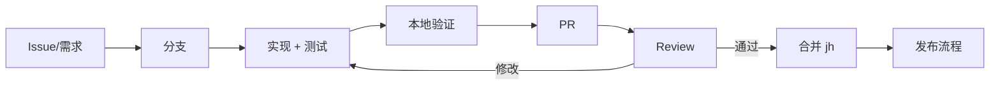

# 协作流程

## 1. 分支模型

| 分支 | 用途 | 规则 |
|------|------|------|
| `jh` | 当前定制主线 | 保护分支，只能通过 PR 合入 |
| `master` | 上游通用线（`/v2`） | 与 `jh` 不直接合并 |
| `feat/<topic>` | 新功能 | 从 `jh` 拉出 |
| `fix/<topic>` | 缺陷 | 从 `jh` 拉出 |
| `docs/<topic>` | 文档 | 可只改 `docs/` |
| `hotfix/<version>` | 线上紧急修复 | 从 tag 拉出，合并回 `jh` 并打 patch |

命名用小写与连字符：`feat/ratelimit-header`、`fix/sqlite-path`。

## 2. 提交信息

```
<type>(<scope>): <subject>

<body>
<footer>
```

| type | 用途 |
|------|------|
| `feat` | 新能力 |
| `fix` | 修复 |
| `refactor` | 不改变行为的重构 |
| `perf` | 性能 |
| `test` | 测试 |
| `docs` | 文档 |
| `build` / `chore` | 构建、依赖、杂项 |

示例：

```
fix(logsink): 队列上限与文档不一致

- normalize 上限改为 DefaultQueueSize(1024)
- 配置文件仍限制 100，避免内存放大

Refs: #124
```

要求：一个提交一件事；格式化与逻辑分开；不提交日志、二进制、真实配置。

## 3. 开发流程



### 3.1 开始前

- 确认需求属于本分支能力范围（[边界](../../../README.md#24-当前分支未实现的能力)）。
- 涉及导出 API/配置键/表结构时，先写一段设计说明（PR 描述即可）。

### 3.2 本地验证

```bash
gofmt -l $(git ls-files '*.go' | grep -v '^.Trash-0/')
go build ./...
(cd cmd && go build ./...)
go vet ./...                      # 历史告警见测试策略
go test ./health/ ./metrics/ ./logs/ ./logsink/ ./utils/ \
        ./middleware/cors/ ./middleware/limit/ ./middleware/ratelimit/
```

### 3.3 PR 描述模板

```markdown
## 变更
- ...

## 动机
- ...

## 影响面
- 配置键：无 / 新增 xxx
- 协议：无 / 变更 xxx
- 表结构：无 / 新增 xxx
- 兼容性：向后兼容 / BREAKING

## 验证
- [ ] go build ./...
- [ ] 单元测试（列出包）
- [ ] 手工验证（命令与结果）

## 文档
- [ ] README / docs 已更新
```

## 4. 评审

| 角色 | 关注 |
|------|------|
| 维护者 | 设计一致性、兼容性、性能与安全 |
| 模块 Owner | 该包的正确性与测试 |
| 文档评审 | 术语、链接、示例可运行 |

规则：

- 至少 1 名维护者 approve；
- 破坏性变更需要 2 名；
- 评审意见用「必须修改 / 建议 / 提问」区分；
- 作者负责解决冲突与更新文档，不由评审者代改。

## 5. 合并策略

- 使用 **Squash merge**：一个 PR 一个提交，保留 PR 号。
- 合并前确保 CI/本地验证通过；无 CI 时由作者贴出命令输出。
- 合并后删除远端分支。
- 不直接在 `jh` 上提交；不 force push 受保护分支。

## 6. 冲突处理

```bash
git fetch origin
git rebase origin/jh
# 解决冲突 → go build ./... → git rebase --continue
git push --force-with-lease
```

只在自己的功能分支上 rebase/force push，且使用 `--force-with-lease`。

## 7. 文档同步

以下变更必须同时更新文档，否则不予合并：

| 变更 | 更新位置 |
|------|----------|
| 新增/删除能力 | `README.md` §2、§2.4 |
| 新增配置键 | `README.md` §5、`08-reference/variables.md`、示例 YAML |
| 导出 API 变化 | `08-reference/api/README.md` |
| 类型/字段变化 | `08-reference/types.md` |
| 协议/错误码变化 | `08-reference/protocols.md` |
| 表结构变化 | `03-development/04-data-access.md` |
| 已知问题变化 | `11-appendix/03-migration-and-known-issues.md` |

## 8. 发布衔接

合并到 `jh` 不等于发布。版本、CHANGELOG、tag 与验证见 [发布规范](04-release-process.md)。

## 9. 行为准则

- 对事不对人；用代码、日志、复现步骤讨论。
- 不提交他人的密钥/隐私数据；发现泄露立即上报。
- 不为了让测试通过而删除断言或跳过关键用例。
